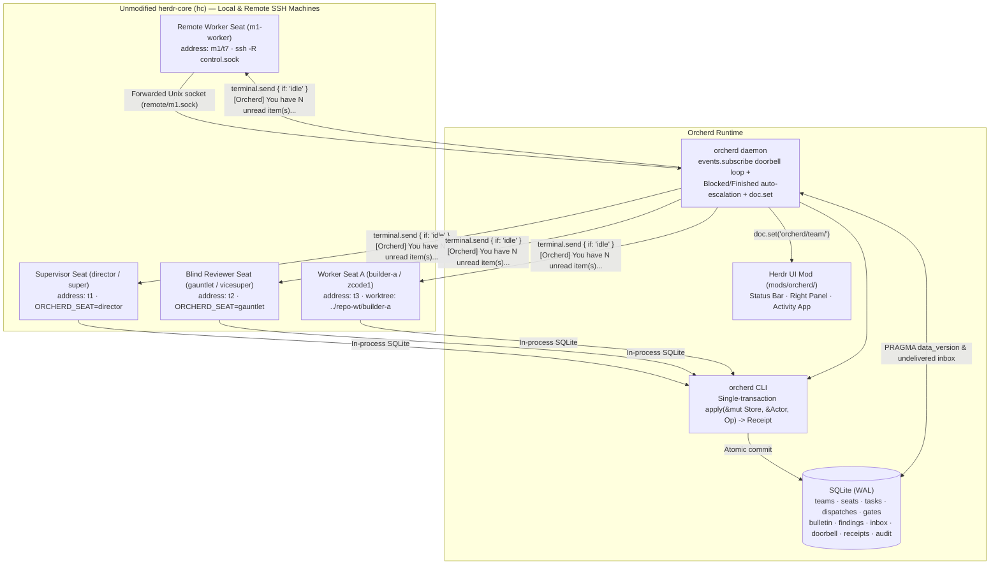

<p align="center">
  
</p>

<h1 align="center">Orcherd (<code>orcherd</code>)</h1>

<p align="center">
  <strong>Orch</strong>estration + <strong>Herd</strong>r + an <strong>Orchard</strong> of git <strong>worktrees</strong>.<br />
  Standalone multi-agent team orchestration on unmodified <a href="https://herdr.dev/"><code>herdr-core</code> (<code>hc</code>)</a>.
</p>

<p align="center">
  <a href="SPEC.md"><strong>Architecture &amp; Spec</strong></a> ·
  <a href="docs/COMPARISON.md"><strong>Herding vs. Orca vs. Orcherd</strong></a> ·
  <a href="docs/ORIGIN-AND-LESSONS.md"><strong>Origin &amp; 6 Design Laws</strong></a>
</p>

---

## Why Orcherd?

`orcherd` is a single ~7 MB static Rust binary that coordinates multi-agent engineering and creative teams (Antigravity, Claude Code, ZCode, Codex, OpenCode) across local git worktrees and remote SSH machines. It fuses the best parts of **Orca Orchestration** and **Herding Teams** while eliminating both of their failure modes:

| Capability | Herding Teams (`herding team`) | Orca (`orca orchestration`) | Orcherd (`orcherd`) |
| --- | --- | --- | --- |
| **Runtime & State** | Coupled to 9,000-line GPUI window fork (`control.sock`) | Electron/Node IDE daemon (`orcad-server.js`) | **In-process WAL SQLite** (`store.sqlite3`) + lightweight `orcherd daemon` |
| **Agent Sessions & OAuth** | Persistent names, brittle `/proc` + pane ID re-registration | Ephemeral `dispatch:<id>` processes (hourly OAuth sign-outs) | **Persistent Warm Seats + Dispatches** (keeps OAuth sessions signed in all day) |
| **Wake Delivery** | Full-prompt PTY pastes (truncated text, missing-Enter races) | Turn-ending push wakes via `orcad` | **Payload-free 1-line doorbells** via `hc` `terminal.send { if: "idle" }` |
| **Task Board & QA** | Flat task list; manual review routing | Hub-and-spoke mail only; no board or DAGs | **Task DAGs (`--deps`) + Enforced Blind Review (`reviewer != assignee`)** |
| **Worktree Setup** | Manual `git worktree add` + manual symlinks | `--worktree new-child`, manual `.env`/`.venv` symlinks | **Declarative `.orcherd.toml`** auto-symlinks `.env`, `.venv`, `node_modules`, `work/` |
| **Skill Sync** | Static on-disk markdown (drifts from binary) | Compiled-in `skills get` stub | **Compiled-in 2-tier `orcherd skills get`** + 6 progressive `--reference` guides |
| **UI Integration** | Custom forked Rust views | Custom Electron views | **Zero-fork Luau Herdr UI Mod** (`mods/orcherd/` via `doc.set`) |

---

## System Architecture



### The Six Design Laws

1. **Law 1 — No UI Socket in the Path**: Local CLI calls open `<state_dir>/orcherd/store.sqlite3` directly in-process (`WAL`, `busy_timeout = 5000ms`). Closing or restarting the GUI never drops team state.
2. **Law 2 — Payload-Free Doorbells**: Multi-line briefs, questions, and reports never touch a terminal paste buffer. Payloads are written transactionally to `inbox`; `orcherd daemon` sends only a 1-line doorbell (`[Orcherd] You have N unread item(s)... Run: orcherd inbox`) when `herdr-core` reports the seat is `idle`.
3. **Law 3 — Persistent Seats vs. Per-Task Dispatches**: Roster seats (`builder-a`, `gauntlet`, `zcode1`) stay open across tasks so signed-in CLIs retain OAuth tokens and repo caches. Every task attempt is tracked as an immutable `Dispatch` bound in SQLite *before* terminal launch.
4. **Law 4 — Enforced Reviewer Blindness & 3-Strike Circuit Breaker**: The store refuses any task creation, assignment, claim, or verdict where `reviewer_seat == assignee_seat`. Three consecutive review `fix` rounds or three dispatch crashes automatically trip an escalation gate to the supervisor.
5. **Law 5 — Auto-Escalation on `Blocked` or `Finished`**: When `herdr-core` emits `StatusState::Blocked` (an OAuth sign-in or permission dialog) or unexpected `TerminalState::Finished`, `orcherd daemon` immediately wakes the supervisor with an `escalation` inbox item.
6. **Law 6 — Human-Gated Roster Mutations**: `orcherd seat remove` and `orcherd seat handoff` create pending human approval gates (`orcherd pending` / `orcherd approve`) that refuse callers whose environment resolves to an agent seat.

---

## Installation

```sh
# Build and install the standalone binary to ~/.local/bin/orcherd
cargo install --path crates/orcherd-cli --root ~/.local

# Install the static discovery stub to ~/.agents/skills/orcherd/SKILL.md
orcherd skills install

# (Optional) Install the declarative Herdr UI mod to ~/.config/herdr/gpui-mods/orcherd/
orcherd mod install
```

Verify the bundled version-matched guide at any time:

```sh
orcherd skills get orcherd
orcherd skills get orcherd --references
```

---

## Built-In Crew Templates

Initialize a project roster in one command with `orcherd init --name <team> --template <template>`:

| Template | Seats Seeded | Default Harnesses | Best For |
| --- | --- | --- | --- |
| **`studio-crew`** | `director` (supervisor)<br>`builder-a`, `builder-b` (workers)<br>`gauntlet`, `viewer-value` (reviewers) | `director`: `claude`<br>builders & reviewers: `antigravity` | Creative, media, or A/B implementation workflows where two builders produce intentional variants in separate child worktrees and blind reviewers grade them. |
| **`review-crew`** | `super` (supervisor)<br>`vicesuper` (reviewer)<br>`planner` (planner)<br>`zcode1..3` (workers) | `super` & `vicesuper`: `claude`<br>`planner`: `opencode`<br>`zcode1..3`: `antigravity` | Software engineering repositories with task DAGs, full-diff review gates (`vicesuper`), and parallel feature worktrees. |
| **`small`** | `super` (supervisor)<br>`w1..3` (workers) | `super`: `claude`<br>`w1..3`: `antigravity` | Fast parallel task execution without a dedicated reviewer seat. |

---

## End-to-End Workflow Walkthrough

### 1. Configure Worktree Bootstrapping (`.orcherd.toml`)

Drop an optional `.orcherd.toml` at your repository root so every `--worktree new-child` automatically symlinks git-ignored runtime dependencies (`.env`, virtualenvs, `node_modules`, media caches) before the agent starts:

```toml
[team]
name = "ksquared"
template = "studio-crew"
goal = "Ship W38 Shorts"
bootstrap_symlinks = [
  ".env",
  ".venv",
  "node_modules",
  "formats/gta6/.venv",
  "formats/gta6/work",
]
bootstrap_copies = []
```

### 2. Initialize Team & Build a Task DAG

```sh
# Seed the studio-crew roster
orcherd init --name ksquared --template studio-crew --goal "Ship W38 Shorts"

# Create Task 1 (with blind reviewer `gauntlet`) and Task 2 (blocked on Task 1 via --deps)
orcherd task create --title "1.1 Cut A baseline" --spec-file briefs/cut-a.md --reviewer gauntlet --json
orcherd task create --title "1.2 Final composite" --spec-file briefs/composite.md --deps <task_1_id> --json
```

### 3. Spawn or Reuse Persistent Seats

```sh
# Launch builder-a in an isolated child worktree (<repo>-wt/builder-a on branch orcherd/builder-a)
orcherd spawn --seat builder-a --agent antigravity --model gemini-4-neon-high \
  --worktree new-child --task <task_1_id> --spec-file briefs/cut-a.md --json
```

### 4. Inside the Worker Seat: `inbox`, `ask`, and `done`

When woken by `[Orcherd] You have 1 unread item(s)... Run: orcherd inbox`:

```sh
# 1. Read the assigned task brief
orcherd inbox

# 2. If blocked on a design decision, open a decision gate and end turn
orcherd ask --question "Should Cut A keep the cold-open telemetry HUD?"

# 3. Once verified complete, submit the structured completion report and end turn
orcherd done --result-file reports/cut-a-done.md --branch orcherd/builder-a --commit a1b2c3d
```

### 5. Inside the Supervisor & Blind Reviewer Seats: `reply` and `verdict`

```sh
# Supervisor answers a pending decision gate (automatically unblocks task & wakes builder-a)
orcherd inbox
orcherd reply <gate_id> --body-file answers/hud-yes.md

# Blind reviewer (`gauntlet`) inspects the commit and posts a verdict (pass | fix | escalate)
orcherd inbox
orcherd verdict <task_1_id> --verdict pass --body-file reviews/cut-a-pass.md
```

When `gauntlet` records `--verdict pass`, Task 1 transitions to `completed` and Task 2 (`--deps <task_1_id>`) **automatically transitions from `pending` to `ready`**.

---

## Cross-Machine Fleet Execution (`--on <machine>`)

`orcherd` spans remote machines configured in `herdr-core` (`hc machine add m1 <host>`) without requiring a separate database or daemon on remote hosts:

```sh
# 1. Start the reverse SSH Unix-socket control tunnel for machine `m1`
orcherd tunnel m1

# 2. Spawn a remote seat on `m1` (addressed by herdr-core as `m1/t7`)
orcherd spawn --seat m1-builder --on m1 --agent zcode --worktree current \
  --spec-file briefs/m1-slice.md --json
```

Outbound doorbells flow through `herdr-core` to `m1/t7`; inbound `orcherd inbox`, `orcherd ask`, and `orcherd done` calls from `m1-builder` travel over the forwarded Unix socket (`remote/m1.sock`) back to the supervisor's SQLite store, automatically recorded in `orcherd log` as `m1/t7`.

---

## CLI Reference

Every command supports `--json`, `--team <name|id>`, `--request-id <id>`, and `--as <seat>`, plus subcommand `--help` (`orcherd <command> --help`).

| Category | Command | Purpose |
| --- | --- | --- |
| **Setup & Skills** | `orcherd init` | Initialize a team (`--name`, `--template`, `--goal`, `--bootstrap-symlink`) |
| | `orcherd status` | Show team roster, tasks, active dispatches, unread counts, and doorbells |
| | `orcherd skills` | `list` \| `get [orcherd] [--reference <ref>]` \| `install` |
| | `orcherd mod install` | Install the sandboxed Luau UI mod (`status_bar`, `panel`, `activity` app) |
| | `orcherd daemon` | `start` \| `stop` \| `status` \| `run [--once]` |
| | `orcherd tunnel <machine>` | Manage reverse SSH socket forwarding for a remote `hc` machine |
| **Seats & Dispatches** | `orcherd spawn` | Start or warm-reuse a persistent seat (`--seat`, `--agent`, `--worktree`, `--on`, `--spec-file`, `--resume`) |
| | `orcherd seat` | `list` \| `show` \| `read` \| `stop` \| `abandon` \| `release` \| `rebind` \| `remove` \| `handoff` |
| **Task Board & DAGs** | `orcherd task` | `create` (`--deps`, `--assign`, `--reviewer`) \| `list [--ready]` \| `show` \| `assign` \| `claim` \| `update` |
| **Turn Outcomes & Gates** | `orcherd inbox` | Read and mark-read pending assignments, questions, replies, and verdicts (`--peek`) |
| | `orcherd send` | Direct or `@group` message (`--to <seat\|@all\|@idle\|@workers\|@reviewers>`, `--body-file`) |
| | `orcherd ask` | Block active task on a supervisor decision gate (`--question`, `--body-file`) |
| | `orcherd reply <id>` | Resolve a decision gate and wake the waiting worker (`--body-file`) |
| | `orcherd done` | Complete active task and route to reviewer or supervisor (`--result-file`, `--outcome`) |
| | `orcherd verdict <task>` | Record blind review verdict (`--verdict pass\|fix\|escalate`, `--body-file`) |
| | `orcherd gate list` | List decision and human-approval gates (`--status pending\|resolved`) |
| **Bulletin & Governance** | `orcherd bulletin` | `post` (`--to @all`, `--kind post\|handoff\|authorized`, `--body-file`) \| `list [--after <seq>]` |
| | `orcherd finding` | `add` (`--title`, `--confidence verified`, `--evidence-file`) \| `list` |
| | `orcherd pending` / `approve` | List and human-approve guarded seat removals or supervisor role handoffs |
| | `orcherd log` | Inspect the append-only audit trail (`--limit <n>`) |

---

## Repository & Crate Layout

```text
orcherd/
├── AGENTS.md                                  # Engineering & agent conventions (1,000-line ceiling)
├── README.md                                  # Project overview, architecture & quickstart
├── SPEC.md                                    # Locked v1.0 wire, SQLite schema, CLI & mod specification
├── docs/
│   ├── COMPARISON.md                          # Side-by-side comparison: Herding Teams vs. Orca vs. Orcherd
│   └── ORIGIN-AND-LESSONS.md                  # Production post-mortems distilled into the 6 Design Laws
├── crates/
│   ├── orcherd-core/                          # Domain types, WAL SQLite schema, templates & transactional apply()
│   ├── orcherd-hc/                            # Framed JSON-RPC client for unmodified herdr-core (hc)
│   └── orcherd-cli/                           # CLI binary, worktree bootstrapper, daemon, SSH tunnel & embedded skills
├── skills/
│   └── orcherd/
│       ├── SKILL.md                           # Static discovery stub installed to ~/.agents/skills/
│       ├── GUIDE.md                           # Bundled base guide printed by `orcherd skills get orcherd`
│       └── references/                        # Progressive disclosure references (`--reference`)
│           ├── supervisor-loop.md             # Backlog, DAGs, tiered review, AUTHORIZED: push gate
│           ├── seats-and-templates.md         # Persistent seats, warm OAuth reuse, templates, A/B cuts
│           ├── placement-and-remote.md        # Worktrees, bootstrap symlinks, remote `hc` machines
│           ├── messaging-and-gates.md         # Bulletin, @groups, decision gates (ask/reply), human approvals
│           ├── recovery-and-cleanup.md        # Blocked dialogs, circuit breaker, stop/abandon/release/resume
│           └── parallel-start.md              # Starting 2–4 independent seats in one shell turn
└── mods/
    └── orcherd/
        ├── mod.toml                           # Declarative Herdr UI mod manifest (status_bar, panel, activity)
        ├── main.luau                          # Sandboxed Luau view rendering live Orcherd projections
        └── icon.svg                           # Shepherd's crook + worktree orchard icon
```

## Verification

```sh
cargo test --workspace
cargo clippy --workspace --all-targets -- -D warnings
```
