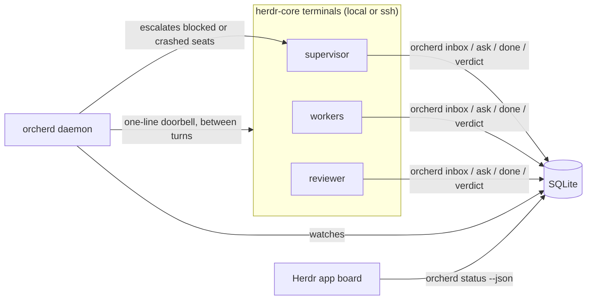

<p align="center">
  
</p>

<h1 align="center">orcherd</h1>

<p align="center">
  Run a team of coding agents (a supervisor, workers, and a blind reviewer)<br />
  across git worktrees and machines, on <a href="https://herdr.dev/">herdr-core</a>.
</p>

<p align="center">
  <a href="#quickstart">Quickstart</a> ·
  <a href="#how-it-works">How it works</a> ·
  <a href="#commands">Commands</a> ·
  <a href="SPEC.md">Spec</a>
</p>

---

orcherd is one Rust binary (~7 MB) with a SQLite store. Agents call it from their terminals:
workers read their brief with `orcherd inbox`, ask with `orcherd ask`, and hand in with
`orcherd done`. Reviewers rule with `orcherd verdict`. The supervisor plans tasks and answers
questions. Each call is one transaction, so the team's state survives crashes, restarts, and
closed windows.

It works with any agent CLI that runs in a terminal: Claude Code, Codex, Antigravity, ZCode, OpenCode.
You can mix them in one team.

## Why not…

| | Claude Code agent teams | Session managers<br><sub>Claude Squad, Conductor</sub> | **orcherd** |
| --- | --- | --- | --- |
| Agents | Claude Code only | Several CLIs, side by side | Any terminal agent, mixed in one team |
| Coordination | Shared task list and messages | You coordinate them | Task DAG, inbox, decision gates, bulletin |
| Review | Plan approval by the lead | You review diffs | A reviewer seat that can't review its own work, enforced |
| Survives restarts | Teammates aren't restored on `/resume` | Sessions persist | Everything is in SQLite; seats stay signed in |
| Worktrees | Not built in | One per session | One per seat, with `.env`/`.venv`/`node_modules` linked in |
| Other machines | Local only | Local only | Seats on any `hc` machine over SSH |
| Status | Experimental | Stable | v0.1 |

Use Claude Code agent teams for a quick Claude-only fan-out inside one session. Use orcherd when
the work runs for hours or days, mixes agents, or needs review you can trust.

## Quickstart

```sh
cargo install --path crates/orcherd-cli --root ~/.local   # installs ~/.local/bin/orcherd
orcherd skills install                                     # teaches your agents the commands
```

You need [herdr-core](https://herdr.dev/) (`hc`) on your `PATH`: orcherd starts every agent in an `hc` terminal.

```sh
# In your repo: a supervisor, two builders, two reviewers
orcherd init --name shorts --template studio-crew --goal "Ship the W38 cut"

# Two tasks; the second waits for the first
orcherd task create --title "Cut A baseline" --spec-file briefs/cut-a.md --reviewer gauntlet
orcherd task create --title "Final composite" --spec-file briefs/composite.md --deps <task-1>

# Start a builder in its own worktree on the first task
orcherd spawn --seat builder-a --worktree new-child --task <task-1> --spec-file briefs/cut-a.md
```

From there the agents drive it. Each seat gets a one-line doorbell, `[Orcherd] You have 1 unread item(s)… Run: orcherd inbox`,
and works through its turn:

```sh
orcherd inbox                                     # builder-a: read the brief
orcherd ask --question "Keep the HUD in the cold open?"    # blocks; the supervisor gets the question
orcherd reply <gate> --body-file answer.md        # supervisor: answers; builder-a is woken
orcherd done --result-file report.md              # builder-a: hands in; goes to gauntlet
orcherd verdict <task-1> --verdict pass --body-file review.md   # gauntlet: task 2 becomes ready
```

`orcherd status` shows the board and `orcherd log` the audit trail.

## How it works



- **State lives in SQLite, not a window.** Commands open `store.sqlite3` in-process (WAL). Each one
  validates, writes, queues inbox items, and logs an audit row in one transaction. Reads write no audit rows.
- **Doorbells carry no payload.** Briefs and answers sit in the inbox. The daemon only types a
  fixed one-liner between turns (when `hc` reports the agent idle or done), so nothing gets truncated or typed into a busy prompt.
  A seat that won't take its doorbell for a minute is reported to the supervisor once.
- **Seats persist; dispatches don't.** A seat (`builder-a`) keeps its terminal across tasks, so the
  agent stays signed in and warm. Each task attempt is a dispatch, recorded before the terminal starts.
- **Review is blind by construction.** A task's reviewer can never be its assignee. Three `fix`
  rounds, or three crashes in a row, escalate to the supervisor.
- **Stuck agents surface.** If `hc` reports a seat blocked (a sign-in or permission prompt) or its
  program exits, the supervisor gets an escalation.
- **Humans approve roster changes.** Removing a seat or handing off the supervisor role waits on `orcherd approve`, which agent seats can't call.

The details, schema, and wire contract are in [SPEC.md](SPEC.md).

## Teams

`orcherd init --template <name>` seeds a roster. Each seat can be started with any agent (`--agent`); these are the defaults.

| Template | Seats | For |
| --- | --- | --- |
| `review-crew` | `super` (claude), `vicesuper` reviewer (claude), `planner` (opencode), `zcode1..3` (antigravity) | Software work with a DAG and full-diff review |
| `studio-crew` | `director` (claude), `builder-a`/`builder-b` (antigravity), `gauntlet`/`viewer-value` reviewers (antigravity) | Two builders making competing variants, graded blind |
| `small` | `super` (claude), `w1..3` (antigravity) | Parallel tasks without a reviewer |

## Worktrees

`--worktree new-child` puts a seat in `<repo>-wt/<seat>` on branch `orcherd/<seat>`. A fresh worktree
lacks your untracked files, so list what to link or copy in `.orcherd.toml`. You can also override
any agent's launch command and base flags under `[agents.<id>]` (`--model` and resume flags still append):

```toml
[team]
name = "shorts"
template = "studio-crew"
bootstrap_symlinks = [".env", ".venv", "node_modules", "work"]
bootstrap_copies = []

[agents.antigravity]
argv = ["agy", "--dangerously-skip-permissions"]
```

Other placements: `current`, `new-top-level`, `path:<dir>`. For local Antigravity (`agy`) seats in `new-child`/`new-top-level` worktrees, `orcherd` inherits `trustedWorkspaces` from the parent repo when it is already trusted.

## Other machines

Seats can run on any machine `hc` knows (`hc machine add m1 <host>`). The store stays on your machine:

```sh
orcherd tunnel m1                                  # forwards orcherd's socket to m1 over ssh -R
orcherd spawn --seat m1-builder --on m1 --spec-file brief.md
```

Commands the remote seat runs reach your store through the tunnel and are logged as `m1/<terminal>`. The daemon watches recorded tunnels and restarts them with backoff if SSH drops (escalating after repeated failures) until you run `orcherd tunnel m1 --stop`. `orcherd init` always creates teams in the local store (never through a tunnel), local seats inherit a custom `ORCHERD_STATE_DIR`, and tunneled `team not found` errors name the remote host and tunnel socket.

## Herdr app board

```sh
orcherd mod install
```

This adds a team board to the [Herdr desktop app](https://github.com/herdrdev/herdr-app). The board lists
open decisions first, then seats with live status and unread counts, tasks by state, and every other team's live
agents grouped by team. Beside them runs a live bulletin in full markdown, with new posts marked. Click an agent to
jump to its tab.
Its **freeze** button (click twice) stops the whole team. It also posts a notification for each new question.
Open it from the palette with **Orcherd: team board**.

Each team gets its own Herdr space, and the seats you spawn open there as tabs (`--no-ui` keeps one headless). Switch Herdr's Agents list to
**Grouped by space** to see your agents grouped by team.

## Commands

Every command takes `--json`, `--team`, `--as <seat>`, and `--request-id` (safe retries), plus
`orcherd <command> --help`. Without `--team`, every command resolves `$ORCHERD_TEAM`, then
`.orcherd.toml` `[team] name` up to the git root, then the deepest matching `workspace_root`
(newest on a tie), then the newest team in the store. Long text always comes from a file:
`--spec-file`, `--body-file`, `--result-file`.

| | |
| --- | --- |
| `init`, `status`, `log` | Create a team; show the board; show the audit trail |
| `spawn`, `seat …` | Start or reuse a seat; list, read, stop, release, rebind, remove, hand off, set its standing brief |
| `task …` | `create` (`--deps`, `--reviewer`, `--assign`), `list`, `show`, `assign`, `claim`, `update`, `reopen` (another round, same count) |
| `inbox`, `send` | Read your items (`--peek` to leave them unread); message a seat or `@all`/`@idle`/`@workers`/`@reviewers` |
| `ask`, `reply`, `gate list` | Block on a decision; answer it; list open decisions |
| `done`, `verdict` | Hand in a task; review it (`pass`, `fix`, `escalate`) |
| `bulletin …`, `finding …` | Team-wide posts; durable evidence records |
| `pending`, `approve` | Human approvals for roster changes |
| `freeze`, `unfreeze` | Stop the whole team now (notify all, interrupt busy seats, refuse new work); resume |
| `daemon …`, `preflight`, `tunnel` | Doorbells and escalations; check `hc` vs. shell agent PATH/version; remote machines |
| `skills …`, `mod install` | Agent guide (`skills get orcherd`); the Herdr app board |

Agents load the full guide, matched to the binary's version, with `orcherd skills get orcherd`.

## Development

```sh
cargo test --workspace
cargo clippy --workspace --all-targets -- -D warnings
```

Three crates: `orcherd-core` (types, schema, the `apply` transaction), `orcherd-hc` (herdr-core
client), and `orcherd-cli` (the binary, daemon, worktrees, tunnel, embedded skill). Rules for
contributors and agents are in [AGENTS.md](AGENTS.md). [docs/ORIGIN-AND-LESSONS.md](docs/ORIGIN-AND-LESSONS.md)
covers the production failures that shaped the design.
