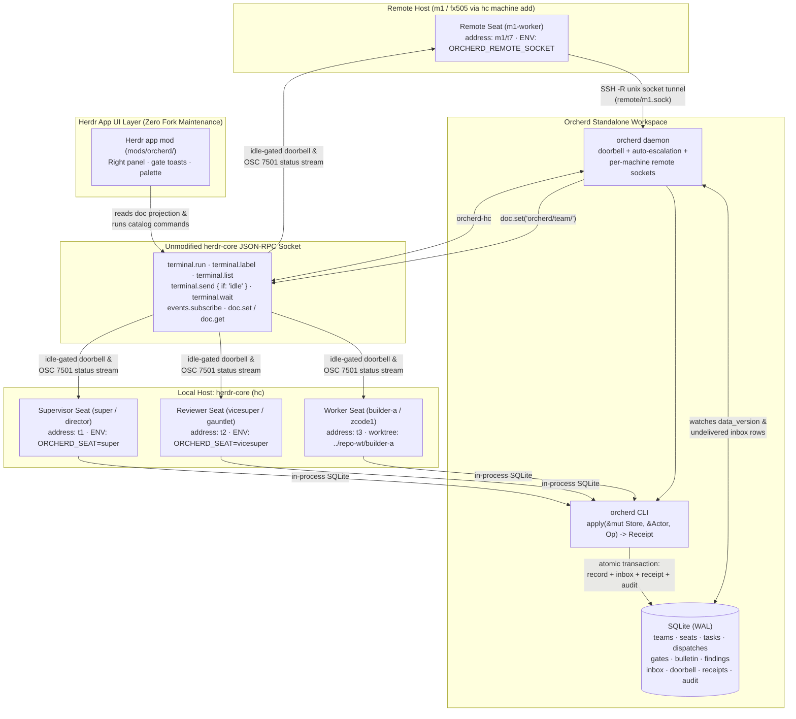
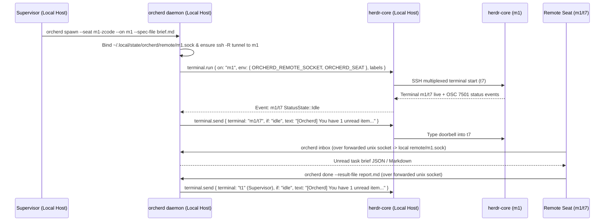

# Orcherd Architecture & Specification (`SPEC.md`)

Status: Locked v1.0 (2026-11-25)
Binary: `orcherd`
Runtime Dependency: Unmodified `herdr-core` (`hc` >= 0.1.13)
Historical Context & Design Laws: [`docs/ORIGIN-AND-LESSONS.md`](docs/ORIGIN-AND-LESSONS.md)

---

## 1. Design Thesis

`orcherd` (**Orch**estration + **Herd**r + an **Orchard** of git **worktrees**) translates multi-agent team orchestration out of a forked GUI layer and directly onto **`herdr-core` (`hc`)**, surfaced inside Herdr's UI as a **declarative UI mod** (`mods/orcherd/`).

It combines two battle-tested halves (detailed in [`docs/ORIGIN-AND-LESSONS.md`](docs/ORIGIN-AND-LESSONS.md)):

1. **From Orca (`orca orchestration`)**:
   - **Two-tier version-matched skill discovery (`orcherd skills get`)**: A tiny static discovery stub in `~/.agents/skills/orcherd/SKILL.md` resolves `$ORCHERD_CLI_COMMAND` once per session and loads the version-matched base guide (`GUIDE.md`) and on-demand `references/*.md` compiled directly into the `orcherd` binary.
   - **Turn-ending reactive push wakes (`done`, `ask`, `reply`, `verdict`, `escalation`)**: Agents never poll or run cron sweeps. Workers end their turn after `done` or `ask`; `orcherd daemon` watches `herdr-core`'s `events.subscribe` stream and rings idle seats with a 1-line doorbell via `terminal.send { if: "idle" }`.
   - **File-first, idempotent CLI (`--spec-file`, `--body-file`, `--result-file`)**: Eliminates shell quoting and PTY paste truncation. Every mutation is keyed by `(team_id, caller_id, request_id)` in `mutation_receipts` and returns a JSON receipt with `failed_stage` and a conditional `next` hint.
2. **From Herding Teams (`herdr-team` & `herdr-supervisor`)**:
   - **Persistent named seats & warm session reuse**: Keep role-aware seats (`super`/`director`, `vicesuper`/`gauntlet`, `planner`, `builder-a`, `builder-b`, `zcode1..3`) warm across tasks so OAuth-authenticated CLIs (Antigravity, Claude, ZCode, Codex) stay signed in all day and retain role memory.
   - **Claimable Task Board with DAG `deps` & Blind Reviewer Gates**: Tasks support `--deps`, GitHub issue links, and automatic `reviewer_seat` routing (`reviewer_seat != assignee_seat`), plus the `AUTHORIZED: push` landing discipline.
   - **Shared Threaded Bulletin, Durable Findings & Audit Log**: All stored in a single WAL SQLite database (`<state_dir>/orcherd/store.sqlite3`) opened directly in-process by local CLI calls.
   - **First-Class Cross-Machine Fleet Support**: Spawn and coordinate seats across remote machines (`m1`, `m2`, `fx505`, `yeti-cachy`) over `herdr-core` (`hc machine add` + `terminal.run { on }`) and an auto-managed SSH unix-socket control tunnel.

---

## 2. System Architecture



### Workspace Crate Boundaries

| Path | Responsibility | Allowed Dependencies |
| --- | --- | --- |
| `crates/orcherd-core` | Domain types (`Op`, `Receipt`, `Actor`, `Address`, `Seat`, `Task`, `Dispatch`, `Gate`, `Post`, `Finding`, `InboxItem`, `TeamProjection`), WAL SQLite store, additive migrations (`PRAGMA user_version`), and single-transaction `apply(&mut Store, &Actor, Op) -> Result<Receipt>`. | `rusqlite`, `serde`, `serde_json`, `chrono`, `uuid`, `thiserror`, `tracing` |
| `crates/orcherd-hc` | Framed JSON-RPC client for unmodified `herdr-core` (`hc`): endpoint discovery (`HC_SOCKET`, `XDG_RUNTIME_DIR/herdr-core/<session>.sock`), `core.start`, `terminal.run`, `terminal.send` (`only_if: Some("idle")`), `terminal.wait`, `terminal.list`, `terminal.label`, `terminal.kill`, `events.subscribe`, `doc.get`/`doc.set`, and readiness-checked agent launch (`agent::launch`, `reply::when_free`). | `serde`, `serde_json`, `toml`, `thiserror`, `tracing`, `rustix` (unix) |
| `crates/orcherd-cli` | `orcherd` binary: CLI argument parsing, environment caller resolution, git worktree manager & `.orcherd.toml` symlink/copy bootstrapper, embedded `skills get`/`install`, `orcherd daemon` delivery & escalation worker, and `orcherd tunnel` per-machine SSH socket forwarder. | `orcherd-core`, `orcherd-hc`, `clap`, `toml` |
| `skills/orcherd` | Static discovery stub (`SKILL.md`), bundled base guide (`GUIDE.md`), and progressive disclosure `references/*.md` compiled into `orcherd-cli` via `include_str!`. | Markdown only |
| `mods/orcherd` | Herdr desktop app mod (`mod.json`, `main.js`, `icon.svg`): right-hand team board, gate toasts, palette commands. | JavaScript (gpui-kit, `herdr-app`) |

---

## 3. Core Domain Model & Lifecycle

### 3.1 Teams, `.orcherd.toml`, and Worktree Bootstrapping (`teams`)
A **Team** is scoped to a project root and optionally configured via `.orcherd.toml`:

```toml
[team]
name = "ksquared"
template = "studio-crew"
# Git-ignored paths in the root checkout symlinked into every new child worktree:
bootstrap_symlinks = [".env", ".venv", "node_modules", "formats/gta6/.venv", "formats/gta6/work"]
# Optional relative paths copied (not symlinked) into a new child worktree:
bootstrap_copies = []

# Optional per-agent base launch argv. Replaces the built-in binary and base flags;
# --model and resume flags are still appended by `orcherd spawn`.
[agents.antigravity]
argv = ["agy", "--dangerously-skip-permissions"]
```

### 3.2 Persistent Seats (`seats`) vs. Dispatches (`dispatches`)
To avoid both Herding v1's brittle pane bindings and Orca's hourly OAuth sign-out problem on fresh processes, `orcherd` separates **Seat** from **Dispatch**:

1. **Seat (`seat_id`, `name`, `role`)**:
   - A durable member on the roster (`super`, `vicesuper`, `planner`, `zcode1`, `director`, `builder-a`, `gauntlet`).
   - Holds `role` (`supervisor`, `reviewer`, `planner`, `worker`), `agent` (`claude`, `zcode`, `codex`, `opencode`, `antigravity`), `model`, `account`, `effort`, `worktree_path`, `keep_open` (default `true`), and `resume_session`.
   - Holds a mutable `Address`:
     ```rust
     pub enum Address {
         Core { machine: Option<String>, terminal: String }, // None => "t4", Some("m1") => "m1/t7"
         Herdr1Pane { pane: String },                        // pull-only compatibility fallback
         None,
     }
     ```
2. **Dispatch (`dispatch_id`, `task_id`, `seat_id`)**:
   - A single tracked execution attempt of a `Task` on a `Seat`.
   - **Transactional Binding before Launch**: `apply(Op::Spawn)` creates and commits the `(task_id, seat_id, dispatch_id)` records and the worker's `inbox` row **before** `orcherd` touches `herdr-core`, making brief swaps between concurrent spawns impossible.
   - **Cold Seat Start**: If the seat has no live terminal on `herdr-core`, `orcherd` prepares the worktree (`current`, `new-child`, `new-top-level`, or `path:<dir>`), runs `bootstrap_symlinks`, inherits `agy` `trustedWorkspaces` for local `antigravity` seats in `new-child`/`new-top-level` worktrees when `workspace_root` is already trusted (leaving settings untouched with a `next` note if untrusted, unreadable, or remote), resolves the launch `argv` (from `[agents.<id>].argv` in `.orcherd.toml` when set, else the built-in base, then appending `--model` and resume flags), calls `terminal.run` with:
     - `env`: `ORCHERD_CLI_COMMAND`, `ORCHERD_TEAM`, `ORCHERD_SEAT`, `ORCHERD_DISPATCH`, `ORCHERD_STATE_DIR` (local seats when non-default), `ORCHERD_MACHINE` (if remote), `ORCHERD_REMOTE_SOCKET` (if remote)
     - `labels`: `orcherd.team`, `orcherd.seat`, `orcherd.role`, `orcherd.dispatch`
     and waits for `agent::ready` before sending the initial doorbell. When `--model` is set on a harness whose first screen names the active model (such as `agy`), `orcherd spawn` reads a bounded slice of the screen via `terminal.read` (bounded to ~20 s): a matching screen records `model_check.status = "verified"`, a mismatching screen kills the wrong-model terminal and fails loudly with `failed_stage: "model_mismatch"` and the observed line in `next` (leaving the seat unbound so it never silently runs the wrong model), and an unrecognised screen records `model_check.status = "unverified"` without failing.
   - **Receipt after binding**: `spawn` prints its receipt only after the terminal is bound, with the seat re-read from the store, so `address` is the new terminal (never a pre-bind `none`). If the run or the bind fails, the receipt names the `failed_stage` and the command exits 1.
   - **Warm Seat Reuse**: If the seat already has a live `herdr-core` terminal running the matching agent (`reply::agent_in_front`), `orcherd` does **not** spawn a new OS process. It updates `dispatches` and writes the new task brief to `inbox`; `orcherd daemon` rings the warm terminal as soon as its status is `idle`.
   - **Reboot / Crash Resume (`--resume`)**: Relaunches the seat's harness with its saved `resume_session` (`claude --resume <id>`, `zcode --resume <id>`, `agy --conversation=<id>`) in its existing `worktree_path` and updates `address_terminal`.

### 3.3 Tasks, DAGs, and Enforced Blind Review (`tasks`)
- Tasks declare prerequisite task IDs in `deps` (JSON array). When a task completes inside `apply(Op::Done)`, any `pending` task whose `deps` are now all `completed` transitions atomically to `ready`.
- Tasks may specify `reviewer_seat` (e.g. `vicesuper` or `gauntlet`).
- **Reviewer Blindness Invariant**: `apply()` rejects any task assignment where `reviewer_seat == assignee_seat`, and rejects `Op::Verdict` from the seat that built the task.
- When `assignee_seat` calls `orcherd done --result-file ...`:
  - If `reviewer_seat` is `None`, the task moves to `completed` (or `review` if team policy requires supervisor diff check) and wakes the `supervisor`.
  - If `reviewer_seat` is `Some(rev)`, the task moves to `review` and writes an inbox row (`review_requested`) for `rev` (plus a status notice for `supervisor`).

### 3.4 Turn Outcomes & Decision Gates (`done`, `ask`, `reply`, `verdict`)
- **Terminal task guard**: `done`, `verdict`, `ask <task_id>`, `task assign`, and `spawn --task` are refused on `completed`, `failed`, or `cancelled` tasks (replayed requests with the same `--request-id` still return their original receipt); only `task reopen` moves a finished task back.
- **`orcherd ask [<task_id>] --question "<text>" [--body-file <path>]`**:
  - Creates a `pending` row in `gates` (`kind = 'question'`), marks the task `blocked`, and writes an urgent `question` item to the Supervisor's `inbox`. The worker ends its turn.
- **`orcherd reply <gate_id|item_id> --body-file <path>`**:
  - Marks the gate `resolved`, restores the blocked task to `in_progress`, writes `gate_resolved` to the worker's `inbox`, and wakes the worker.
- **`orcherd verdict <task_id> --verdict pass|fix|escalate --body-file <path>`**:
  - `pass`: Marks the task review-approved (`completed` or ready for supervisor fast-forward), unblocks dependent DAG tasks, and wakes the Supervisor.
  - `fix`: Increments `tasks.review_round`, transitions the task back to `in_progress`, and wakes `assignee_seat` with the numbered fix round; the Supervisor gets a copy (`… (sent to <seat>)`). If `review_round >= 3`, auto-escalates to `supervisor`.
- **`orcherd task reopen <task_id> --spec-file <path>`** (supervisor or human): moves a `completed`, `failed` or `cancelled` task back to `assigned` with the new spec and sends it to the same assignee. `review_round` is kept, so the three-FIX escalation counts across follow-up rounds. Refused while the team is frozen.
- **`orcherd seat brief <seat> --brief-file <path>`** (supervisor or human): sets `seats.standing_brief` and sends it to the seat as a `notice`. `spawn` sends it again whenever the seat starts in a fresh terminal (not on warm reuse).
  - `escalate`: Marks the task `blocked`, creates an `escalation` gate for the Supervisor/human owner, and rings the Supervisor.

---

## 4. SQLite Schema (`store.sqlite3`)

Opened with `PRAGMA journal_mode = WAL; PRAGMA busy_timeout = 5000; PRAGMA foreign_keys = ON;`. Versioned via `PRAGMA user_version` (currently 3; v2 adds `teams.paused_reason`, the reason `orcherd freeze` records and every refused caller sees; v3 adds `mutation_receipts.team_id` so `--request-id` scopes per team). Migrations are additive and run on open. Any binary seeing `user_version > SCHEMA_VERSION` returns `Error::SchemaTooNew { found, supported }` without writing.

```sql
CREATE TABLE teams (
    team_id             TEXT PRIMARY KEY,
    name                TEXT NOT NULL UNIQUE,
    goal                TEXT NOT NULL DEFAULT '',
    template            TEXT,
    workspace_root      TEXT NOT NULL,
    bootstrap_symlinks  TEXT NOT NULL DEFAULT '[]',
    bootstrap_copies    TEXT NOT NULL DEFAULT '[]',
    paused_at           TEXT,
    paused_reason       TEXT,          -- v2: why the team is frozen
    created_at          TEXT NOT NULL,
    updated_at          TEXT NOT NULL
);

CREATE TABLE seats (
    team_id             TEXT NOT NULL,
    seat_id             TEXT NOT NULL,
    name                TEXT NOT NULL,
    role                TEXT NOT NULL DEFAULT 'worker'
                        CHECK(role IN ('supervisor', 'reviewer', 'planner', 'worker')),
    agent               TEXT NOT NULL,
    model               TEXT,
    account             TEXT,
    effort              TEXT,
    address_kind        TEXT NOT NULL DEFAULT 'none', -- 'core', 'herdr1', 'none'
    address_machine     TEXT,                       -- NULL for local core, else hc machine name ('m1')
    address_terminal    TEXT,                       -- 't4' locally or 'm1/t7' remotely
    worktree_path       TEXT,
    branch              TEXT,
    keep_open           INTEGER NOT NULL DEFAULT 1,
    resume_session      TEXT,
    standing_brief      TEXT,
    paused_at           TEXT,
    last_seen_at        TEXT,
    created_at          TEXT NOT NULL,
    updated_at          TEXT NOT NULL,
    PRIMARY KEY (team_id, seat_id),
    UNIQUE (team_id, name)
);

CREATE TABLE tasks (
    task_id             TEXT PRIMARY KEY,
    team_id             TEXT NOT NULL,
    parent_id           TEXT,
    title               TEXT NOT NULL,
    spec                TEXT NOT NULL,
    placement           TEXT,
    status              TEXT NOT NULL DEFAULT 'ready'
                        CHECK(status IN (
                            'pending', 'ready', 'assigned', 'in_progress',
                            'blocked', 'review', 'completed', 'failed', 'cancelled'
                        )),
    deps                TEXT NOT NULL DEFAULT '[]',
    assignee_seat       TEXT,
    reviewer_seat       TEXT,
    review_round        INTEGER NOT NULL DEFAULT 0,
    issue_ref           TEXT,
    result              TEXT,
    branch              TEXT,
    commit_sha          TEXT,
    created_by          TEXT NOT NULL,
    created_at          TEXT NOT NULL,
    updated_at          TEXT NOT NULL,
    completed_at        TEXT
);
CREATE INDEX idx_tasks_team_status ON tasks(team_id, status);
CREATE INDEX idx_tasks_assignee ON tasks(team_id, assignee_seat, status);

CREATE TABLE dispatches (
    dispatch_id         TEXT PRIMARY KEY,
    team_id             TEXT NOT NULL,
    task_id             TEXT NOT NULL,
    seat_id             TEXT NOT NULL,
    retry_of_dispatch_id TEXT,
    state               TEXT NOT NULL DEFAULT 'starting'
                        CHECK(state IN (
                            'starting', 'ready', 'working',
                            'settled_succeeded', 'settled_failed',
                            'stopping', 'stop_unknown', 'stopped',
                            'abandoned', 'circuit_broken'
                        )),
    stage               TEXT NOT NULL DEFAULT 'accepted',
    failure_count       INTEGER NOT NULL DEFAULT 0,
    stop_reason         TEXT,                       -- 'exited', 'lost', 'blocked', 'user_stopped'
    machine             TEXT,
    terminal_address    TEXT,
    worktree_path       TEXT,
    consumer_generation INTEGER NOT NULL DEFAULT 0,
    created_at          TEXT NOT NULL,
    updated_at          TEXT NOT NULL,
    settled_at          TEXT
);
CREATE INDEX idx_dispatches_task ON dispatches(task_id);
CREATE INDEX idx_dispatches_seat ON dispatches(team_id, seat_id, state);

CREATE TABLE gates (
    gate_id             TEXT PRIMARY KEY,
    team_id             TEXT NOT NULL,
    task_id             TEXT,
    dispatch_id         TEXT,
    kind                TEXT NOT NULL
                        CHECK(kind IN ('question', 'approval_role', 'approval_remove', 'escalation')),
    asked_by_seat       TEXT NOT NULL,
    to_seat             TEXT NOT NULL,
    question            TEXT NOT NULL,
    payload_json        TEXT NOT NULL DEFAULT '{}',
    status              TEXT NOT NULL DEFAULT 'pending'
                        CHECK(status IN ('pending', 'resolved', 'denied')),
    resolution          TEXT,
    resolved_by         TEXT,
    created_at          TEXT NOT NULL,
    resolved_at         TEXT
);
CREATE INDEX idx_gates_team_status ON gates(team_id, status);

CREATE TABLE bulletin (
    seq                 INTEGER PRIMARY KEY AUTOINCREMENT,
    post_id             TEXT NOT NULL UNIQUE,
    team_id             TEXT NOT NULL,
    author_seat         TEXT NOT NULL,
    reply_to_post_id    TEXT,
    kind                TEXT NOT NULL DEFAULT 'post'
                        CHECK(kind IN ('post', 'verdict', 'handoff', 'authorized', 'system')),
    subject             TEXT NOT NULL DEFAULT '',
    body                TEXT NOT NULL,
    mentions_json       TEXT NOT NULL DEFAULT '[]',
    created_at          TEXT NOT NULL
);
CREATE INDEX idx_bulletin_team_seq ON bulletin(team_id, seq);

CREATE TABLE findings (
    finding_id          TEXT PRIMARY KEY,
    team_id             TEXT NOT NULL,
    author_seat         TEXT NOT NULL,
    task_id             TEXT,
    title               TEXT NOT NULL,
    evidence            TEXT NOT NULL,
    confidence          TEXT NOT NULL DEFAULT 'high'
                        CHECK(confidence IN ('low', 'medium', 'high', 'verified')),
    created_at          TEXT NOT NULL
);
CREATE INDEX idx_findings_team ON findings(team_id, created_at);

CREATE TABLE inbox (
    seq                 INTEGER PRIMARY KEY AUTOINCREMENT,
    item_id             TEXT NOT NULL UNIQUE,
    team_id             TEXT NOT NULL,
    to_seat             TEXT NOT NULL,
    from_seat           TEXT NOT NULL,
    kind                TEXT NOT NULL
                        CHECK(kind IN (
                            'assigned', 'dispatch', 'follow_up', 'mention',
                            'question', 'gate_resolved', 'worker_done',
                            'review_requested', 'verdict', 'escalation', 'notice'
                        )),
    ref_id              TEXT NOT NULL,
    subject             TEXT NOT NULL,
    body                TEXT NOT NULL,
    created_at          TEXT NOT NULL,
    delivered_at        TEXT,
    read_at             TEXT
);
CREATE INDEX idx_inbox_unread ON inbox(team_id, to_seat, read_at, seq);
CREATE INDEX idx_inbox_undelivered ON inbox(team_id, to_seat, delivered_at, seq);

CREATE TABLE doorbell (
    team_id             TEXT NOT NULL,
    seat_id             TEXT NOT NULL,
    rung_through_seq    INTEGER NOT NULL DEFAULT 0,
    rung_at             TEXT,
    attempts            INTEGER NOT NULL DEFAULT 0,
    outcome             TEXT,                       -- 'confirmed', 'unconfirmed', 'status_mismatch', 'blocked', 'unreachable', 'stalled'
    PRIMARY KEY (team_id, seat_id)
);

CREATE TABLE mutation_receipts (
    team_id             TEXT NOT NULL DEFAULT '',
    caller_id           TEXT NOT NULL,
    request_id          TEXT NOT NULL,
    op                  TEXT NOT NULL,
    payload_hash        TEXT NOT NULL,
    state               TEXT NOT NULL DEFAULT 'completed'
                        CHECK(state IN ('pending', 'completed')),
    receipt_json        TEXT NOT NULL,
    created_at          TEXT NOT NULL,
    PRIMARY KEY (team_id, caller_id, request_id)
);

CREATE TABLE audit (
    seq                 INTEGER PRIMARY KEY AUTOINCREMENT,
    team_id             TEXT NOT NULL,
    actor               TEXT NOT NULL,
    terminal            TEXT,
    op                  TEXT NOT NULL,
    ref_id              TEXT,
    detail_json         TEXT NOT NULL DEFAULT '{}',
    at                  TEXT NOT NULL
);
CREATE INDEX idx_audit_team_seq ON audit(team_id, seq);
```

---

## 5. Doorbell & Auto-Escalation Loop (`orcherd daemon`)

One `orcherd daemon` process runs per database file, holding `<state_dir>/orcherd/daemon.lock`. `orcherd init` and `orcherd spawn` auto-start it detached if no process holds the lock. When the `orcherd` binary on disk is replaced (an install or deploy), the daemon re-executes the new one in place within about 10 s, keeping its pid and the lock. A replacement must be unchanged across two 5 s checks and pass `--version` first, so a copy in progress or a broken build never takes over.

### 5.1 Event-Driven Delivery over `herdr-core`
The daemon connects to `herdr-core` (`orcherd_hc::Core`) and subscribes to `events.subscribe`. If `herdr-core` is not yet running when the daemon starts (for example, `orcherd init` before `spawn`) or restarts while the daemon is live, the daemon reconnects and re-subscribes automatically with exponential backoff (1 s up to 30 s) and ticks immediately once connected:

1. **Trigger Events**:
   - `TerminalChange::Status { status: Some(Status { state: StatusState::Idle, .. }), .. }`: Immediately checks if the seat owning that terminal has undelivered `inbox` rows.
   - `TerminalChange::Status { status: Some(Status { state: StatusState::Blocked, kind, msg, .. }), .. }`: Records `doorbell.outcome = 'blocked'` and writes a deduplicated `escalation` row (`stop_reason = 'blocked'`, with `kind` = `permission` | `auth` | `question` and `msg`) to the Supervisor's `inbox`.
   - `TerminalChange::Finished(ended)` or `TerminalChange::Lost(ended)`: If the seat had an unsettled `working` dispatch, transitions the dispatch to `settled_failed` (`stop_reason = 'exited'` or `'lost'`), increments `failure_count` (tripping `circuit_broken` on attempt 3), and writes an `escalation` row to the Supervisor's `inbox`.
   - `Notice::Missed { terminals, .. }`: Re-syncs the full terminal table before taking action.
   - **SQLite `PRAGMA data_version` Poll (every 1s)**: Detects new `inbox` rows written by in-process CLI calls and rings any recipient seat whose turn is over (`idle` or `done`).

2. **Turn-Gated Doorbell Send**:
   - Verify the agent is still the foreground program (`reply::agent_in_front`).
   - Decide from the seat's live `hc` status. `hc send --if` takes only `idle` or `working`, and some harnesses (agy) end a turn as `done` and stay there, so gating on `idle` alone never rang them (#12):
     - `working` -> don't ring; the turn's end (an `idle` or `done` event) triggers the next tick.
     - `idle` -> `terminal.send { only_if: Some("idle"), force: false }`, so the core re-checks as it types.
     - `done`, `error`, or no reported status -> `terminal.send { only_if: None, force: false }`. The core still refuses a terminal blocked on a dialog.
   - Send the fixed payload-free doorbell line:
     ```text
     [Orcherd] You have N unread item(s) (latest: <kind> <ref_id>). Run: orcherd inbox
     ```
   - Record only what happened, so refusals never flood the audit log:
     - `started: Some(true)` -> stamp `inbox.delivered_at`, set `doorbell.outcome = 'confirmed'`, `attempts = 0`.
     - `started: None` (harness does not report OSC 7501) -> stamp `inbox.delivered_at`, set `doorbell.outcome = 'unconfirmed'`.
     - `started: Some(false)` or refused `status_mismatch` / unreachable -> nothing is written; the daemon retries on later ticks and, after 60 s of refusals, records the outcome once, which sends the Supervisor one `escalation` ("isn't taking its doorbell").
     - Refused `blocked` -> once per stall: set `doorbell.outcome = 'blocked'`, wake Supervisor with `escalation`.
   - **Frozen `working` screen detection (#8)**: If a non-supervisor seat has unread inbox items and keeps reporting `working` while its observe-only screen preview (`read_preview`, sampled every 30 s) stays unchanged for 5 min (`STALL_AFTER`), the daemon escalates once via `DaemonEscalate` (`stop_reason = 'stalled'`, `doorbell.outcome = 'stalled'`, without typing into the seat or spending a crash strike). A screen change resets the clock, and leaving `working` or clearing unread items clears tracking.

---

## 6. First-Class Cross-Machine Fleet Architecture

`orcherd` spans machines (`yeti-cachy`, `m1`, `m2`, `fx505`) by pairing `herdr-core`'s native multi-machine terminal bus with an automatic per-host reverse SSH socket tunnel:



1. **Outbound Control & Doorbells (Zero Extra Daemons on Remote Hosts)**:
   - Once a machine is added to `herdr-core` (`hc machine add m1 <lan-ip>`), the local `herdr-core` addresses its terminals as `m1/t7`.
   - Spike 1 and Spike B confirmed that `Run.env`, `Run.labels`, `events.subscribe`, `terminal.send { if: "idle" }`, `Sent` receipts, and dialog refusal all work transparently across `m1/t7`.
2. **Inbound Store Requests (Per-Machine Forwarded Unix Socket)**:
   - The SQLite store has a **single authority**: the supervisor's machine.
   - For each remote machine `<M>`, `orcherd daemon` binds a dedicated local Unix socket `<state_dir>/orcherd/remote/<M>.sock` (mode `0600`) and spawns/supervises:
     ```sh
     ssh -N -o ExitOnForwardFailure=yes -o StreamLocalBindMask=0177 \
       -o ServerAliveInterval=15 -o ServerAliveCountMax=3 \
       -R <remote_state_dir>/orcherd/control.sock:<local_state_dir>/orcherd/remote/<M>.sock <M>
     ```
   - `orcherd spawn --on <M>` sets `ORCHERD_REMOTE_SOCKET=<remote_state_dir>/orcherd/control.sock` and `ORCHERD_MACHINE=<M>` in the remote terminal's environment.
   - When the remote worker runs `orcherd inbox`, `orcherd ask`, or `orcherd done`, the CLI reads `--result-file` / `--body-file` on the remote filesystem, serializes a single bounded JSON `RemoteRequest { actor_env, op }` over `$ORCHERD_REMOTE_SOCKET`, and prints the `Receipt`.
   - Because the request arrives on `remote/<M>.sock`, `orcherd daemon` knows the request came from machine `<M>` and qualifies bare `HC_TERMINAL_ID=t7` as `<M>/t7`.
   - **Local-only commands & tunnel errors**: `orcherd init` (along with `daemon`, `tunnel`, `skills`, `mod install`, and `preflight`) never routes through a tunnel and always acts on the local machine's store. Local seats spawned under a custom `ORCHERD_STATE_DIR` inherit `ORCHERD_STATE_DIR` automatically; remote seats keep `ORCHERD_REMOTE_SOCKET`. When a named team isn't found (locally or through a tunnel), the CLI scans sibling `orcherd*` state dirs read-only (bounded to 10 stores, skipping corrupt or newer-schema DBs) and, if one holds the team, appends `<team> is in <dir>; run with ORCHERD_STATE_DIR=<dir>` (preserving `team not found on <host> (via the tunnel at <sock>): …` for tunneled requests).
   - **Daemon tunnel supervision**: `orcherd tunnel <M>` and `orcherd spawn --on <M>` write `<state_dir>/tunnels/<M>.json` (machine, pid, optional remote socket override and SSH args). Every 30 s, `orcherd daemon` checks each recorded tunnel's pid and restarts dead SSH children with exponential backoff (30 s, 1 m, 2 m … capped at 10 min). After 3 consecutive failed restarts, it writes one deduplicated `escalation` (`stop_reason = 'tunnel_down'`, `ref_id = "tunnel:<M>"`) to the supervisor of each team with seats on `<M>`, clearing backoff and escalation state once the tunnel recovers. `orcherd tunnel <M> --stop` kills the SSH child and removes the record so a deliberately stopped tunnel stays stopped.

---

## 7. Herdr Desktop App Mod (`mods/orcherd/`)

Instead of maintaining a forked GPUI window, `orcherd` renders inside the official Herdr desktop app ([`herdr-app`](https://github.com/herdrdev/herdr-app)) as a **JavaScript mod** in `~/.config/herdr-app/mods/orcherd/` (`$HERDR_APP_HOME/mods/` when set), installed via `orcherd mod install`. Herdr app mods are trusted gpui-kit JavaScript, hot-reloaded on save and validated with `herdr-app check <mod folder>`. The authoritative API is the `herdr.d.ts` / `gpui-kit.d.ts` the app rewrites into its home on every start.

1. **Data path from `orcherd` to the mod**:
   - **Board state** (team, seats, task DAG, pending gates, unread counts): the mod runs `orcherd status --json` with `exec()` every 5 s, from the shown space's folder, so the panel follows the repo in view (no `--team` resolves to the team whose `workspace_root` contains the working directory). `status` and every other pure query (`seat list|show`, `task list|show`, `gate list`, `bulletin list`, `finding list`, `pending`, `log`, `inbox --peek`) are **read-only**: `apply` writes no audit row for them, so polling never floods the audit log. Polling pauses while the window is not presented.
   - **Live seat status**: `orcherd spawn` labels every seat terminal `orcherd.team`, `orcherd.seat`, and `orcherd.role`. The mod matches those labels in the app's live `terminals()` (falling back to the seat's recorded `core` address), so working/blocked/idle dots update without polling.
   - **Teams**: the same labels group every live orcherd agent on the machine by team ("Other teams" under the shown team's board, or "Teams" in a folder without one). Team names come from a one-time read-only `status` per team id. Clicking an agent runs `pane.focus` for seats opened as tabs (`herdr.space` label) and `terminal.peek` for headless ones. Herdr's own Agents list is left as shipped.
   - `orcherd daemon` still publishes `TeamProjection` via `doc.set { name: "orcherd/team/<team_id>" }` for other `herdr-core` clients; the app's mod API cannot read core documents, so the mod does not depend on it.
   - **Bulletin**: the latest posts from `orcherd bulletin list --json` (read-only, not audited), newest first.
2. **Surfaces** (`mod.json`: `"place": "right"`, `"size": 340`):
   - **Right-hand panel**: team name, goal, and working/blocked/gate pills; a **Needs a decision** section for pending `ask` and approval gates (with the exact `orcherd reply` / `orcherd approve` command); seats sorted supervisor → reviewer → planner → worker with role badge, live status dot, current task title, and unread count (click a live seat to `terminal.peek` it); tasks grouped blocked → review → in progress → assigned → ready → waiting on deps → failed, with completed tasks folded.
   - **Freeze**: a banner with the freeze reason while the team is frozen, and a header button that runs `orcherd freeze` / `orcherd unfreeze` as the human (it arms on the first click and fires on a second within 4 s).
   - **One space per team**: `orcherd spawn` labels each local seat terminal `herdr.space=orcherd-<team_id>`. The app adopts it as its own tab in that space, creating the space the first time, so a team's seats share one space and Herdr's Agents list grouped by space groups them by team. The board mod names each unnamed `orcherd-*` space after its team (`space.rename`). Seats placed `--on` another machine and `--no-ui` seats stay headless. Terminals adopted earlier stay where they are, because the app doesn't move an adopted tab when its label changes.
   - **Notifications**: a toast once per newly pending gate (escalations as warnings); clicking it opens the board.
   - **Command palette**: `Orcherd: team board` (`mod.open`) and `Orcherd: refresh board` (`orcherd.refresh`).
3. **Install & migration**: `orcherd mod install` writes `mod.json`, `main.js`, and `icon.svg`, deletes leftover `mod.toml` / `main.luau`, and removes the retired Luau mod at `~/.config/herdr/gpui-mods/orcherd/` (third-party `herdr-gpui`) only when it holds nothing but files orcherd installed.

---

## 8. Complete CLI Contract (`orcherd`)

Every command accepts `--json`, `--team <name|id>`, and `--request-id <id>`. With `--json`, hard CLI errors print `{"ok": false, "error": "..."}` to stdout and exit non-zero. When `--team` is omitted, every command (including `spawn`) resolves the team in order: `$ORCHERD_TEAM`, `[team] name` in `.orcherd.toml` walking up from the working directory to the git root, the deepest `workspace_root` containing the working directory (newest team on a tie), and finally the newest team in the store. Missing task, seat, gate, and dispatch errors name the team searched.

```text
Setup & Skills:
  orcherd init [--name <name>] [--template <review-crew|studio-crew|small>] [--goal <text>] [--json]
  orcherd status [--team <team>] [--json]
  orcherd skills list | get [orcherd] [--reference <path>] | install [--json]
  orcherd mod install [--path <mods_dir>] [--json]
  orcherd freeze (--reason <text> | --reason-file <path>) [--json]   # supervisor or human
  orcherd unfreeze [--json]
  orcherd daemon [start|stop|status] [--json]
  orcherd preflight --agent <id> [--on <hc_machine>] [--json]
  orcherd tunnel <machine> [--remote-socket <path>] [--ssh-arg <arg>...] [--stop] [--json]

Seats & Dispatches:
  orcherd spawn --seat <name> [--role <supervisor|reviewer|planner|worker>]
                [--agent <id>] [--model <id>] [--account <id>] [--effort <low|medium|high|xhigh>]
                [--worktree <current|new-child|new-top-level|path:DIR>]
                [--on <hc_machine>] [--task <task_id>] [--spec-file <path>]
                [--keep-open] [--resume [<session_id>]] [--retry-of <dispatch_id>] [--json]
  orcherd seat list [--include-remote] [--json]
  orcherd seat show <seat> [--json]
  orcherd seat read <seat> [--lines <n>] [--json]
  orcherd seat stop <seat|dispatch_id> [--json]
  orcherd seat abandon <dispatch_id> [--json]
  orcherd seat release <dispatch_id> [--json]
  orcherd seat rebind <seat> [--terminal <hc_terminal>] [--json]
  orcherd seat remove <seat> [--json]          # creates pending human approval gate
  orcherd seat handoff --to <seat> [--json]    # creates pending human approval gate
  orcherd seat brief <seat> --brief-file <path> [--json]

Task Board & DAGs:
  orcherd task create --spec-file <path> [--title <text>] [--deps <id,id>]
                      [--assign <seat>] [--reviewer <seat>] [--issue <owner/repo#n>] [--json]
  orcherd task list [--status <status>] [--ready] [--json]
  orcherd task show <task_id> [--json]
  orcherd task assign <task_id> --to <seat> [--reviewer <seat>] [--spec-file <path>] [--json]
  orcherd task claim <task_id> [--json]
  orcherd task update <task_id> --status <status> [--json]
  orcherd task reopen <task_id> --spec-file <path> [--json]

Turn Outcomes & Gates:
  orcherd inbox [--peek] [--seat <seat>] [--limit <n>] [--json]
  orcherd send --to <seat|dispatch:id|@all|@idle|@workers|@reviewers> --subject <text> --body-file <path> [--json]
  orcherd ask [<task_id>] --question <text> [--body-file <path>] [--json]
  orcherd reply <gate_id|item_id> --body-file <path> [--json]
  orcherd done [<task_id>] --result-file <path> [--branch <name>] [--commit <sha>] [--outcome <succeeded|failed>] [--json]
  orcherd verdict <task_id> --verdict <pass|fix|escalate> --body-file <path> [--json]
  orcherd gate list [--status <pending|resolved|all>] [--json]

Bulletin, Findings & Governance:
  orcherd bulletin post --body-file <path> [--subject <text>] [--to <@seat,@seat>]
                        [--reply-to <post_id>] [--kind <post|handoff|authorized>] [--json]
  orcherd bulletin list [--after <seq>] [--limit <n>] [--json]
  orcherd finding add --title <text> --evidence-file <path> [--task <task_id>]
                      [--confidence <low|medium|high|verified>] [--json]
  orcherd finding list [--json]
  orcherd pending [--json]
  orcherd approve <gate_id> [--json]
  orcherd log [--limit <n>] [--json]
```

---

## 9. Minimal Library & Subagent Implementation Plan

To build the minimal Rust workspace cleanly with parallel subagents, the implementation splits into **5 non-overlapping slices**:

| Slice | Crate / Files Owned | Deliverable & Acceptance Gate |
| --- | --- | --- |
| **P1: Workspace & `orcherd-core` Types + Schema** | `Cargo.toml`, `crates/orcherd-core/src/{lib.rs,error.rs,types.rs,schema.rs}` | Root workspace + `orcherd-core` domain structs/enums (`Op`, `Receipt`, `Actor`, `Address`, `Seat`, `Task`, `Dispatch`, `Gate`, `Post`, `Finding`, `InboxItem`, `Templates`) + SQLite WAL initialization, `PRAGMA user_version = 1`, and `SchemaTooNew` guard. Gate: `cargo test -p orcherd-core schema`. |
| **P2: `orcherd-core` Transactional `apply()` Engine** | `crates/orcherd-core/src/{store.rs,apply.rs,tests.rs}` | Single-transaction `apply(&mut Store, &Actor, Op) -> Result<Receipt>`: team init + templates (`review-crew`, `studio-crew`, `small`), seat upsert/warm reuse, task DAG unblocking (`deps`), reviewer blindness check (`reviewer_seat != assignee_seat`), `ask`/`reply` gates, `done`/`verdict` state machine, `inbox` generation, `mutation_receipts`, and `audit` rows. Gate: `cargo test -p orcherd-core`. |
| **P3: `orcherd-hc` (`herdr-core` JSON-RPC Client)** | `crates/orcherd-hc/src/*` | Self-contained adaptation of `sheprd-core-client` with zero GPUI/sheprd dependencies: `Endpoint::resolve`, `Core::connect`, `terminal.run`, `terminal.send` (`only_if: Some("idle")`), `terminal.wait`, `terminal.list`, `terminal.label`, `events.subscribe`, `doc.get`/`doc.set`, and `agent::launch` / `reply::agent_in_front`. Gate: `cargo test -p orcherd-hc`. |
| **P4: `orcherd-cli` Commands, Skills & Worktree Bootstrapper** | `crates/orcherd-cli/src/{main.rs,cli.rs,identity.rs,skills.rs,worktree.rs,mod_install.rs}` | `orcherd` binary serving all in-process store ops, `orcherd skills list\|get\|install` (embedding `skills/orcherd/*`), `orcherd mod install` (installing `mods/orcherd/*`), and worktree creation + `.orcherd.toml` `bootstrap_symlinks`. Gate: `cargo test -p orcherd-cli`. |
| **P5: `orcherd daemon` & Cross-Machine Tunnel** | `crates/orcherd-cli/src/{daemon.rs,remote.rs,tunnel.rs}` | Event-driven doorbell & auto-escalation loop over `orcherd-hc`, `doc.set` projection for the UI mod, per-machine Unix socket server (`remote/<machine>.sock`), and `orcherd tunnel <machine>` SSH forwarder. Gate: `cargo test --workspace && cargo clippy --workspace --all-targets -- -D warnings`. |
