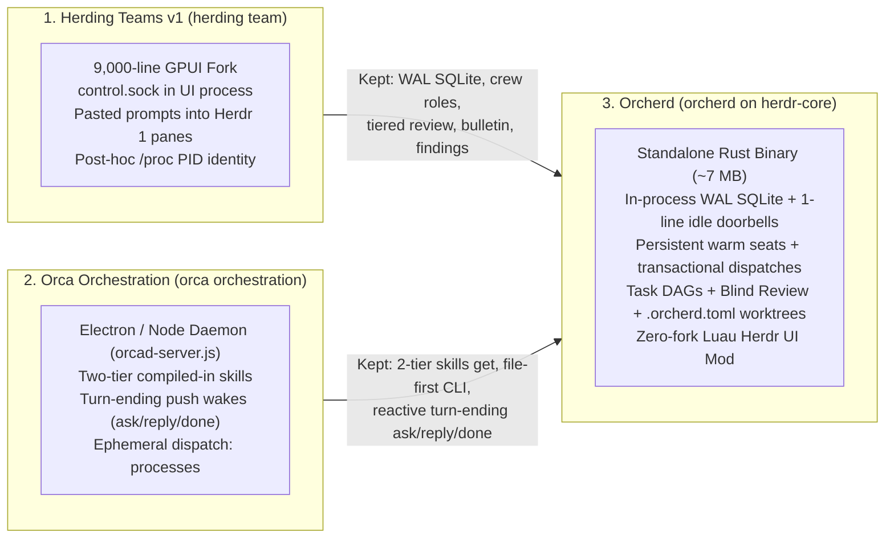

# Multi-Agent Orchestration Comparison: Herding Teams vs. Orca vs. Orcherd

Status: Verified (2026-11-25)
Related: [`SPEC.md`](../SPEC.md) · [`docs/ORIGIN-AND-LESSONS.md`](ORIGIN-AND-LESSONS.md)

This document compares our three generations of multi-agent orchestration systems:

1. **Herding Teams v1 (`herding team`)** — Built inside the `carteakey/herding` GPUI fork on top of Herdr 1 panes (`crates/sheprd-gpui/src/control/server/team`).
2. **Orca Orchestration (`orca orchestration`)** — Built on the Orca Electron/Node IDE daemon (`orcad-server.js`) with ephemeral `dispatch:<id>` workers and turn-ending push wakes.
3. **Orcherd (`orcherd`)** — Standalone pure-Rust orchestrator built directly on unmodified `herdr-core` (`hc`) with an in-process WAL SQLite store, persistent warm seats, task DAGs, enforced blind review gates, and a declarative Luau UI mod.

---

## 1. Architectural Evolution

---

## 2. Architecture & Runtime Comparison

| Dimension | Herding Teams (`herding team`) | Orca (`orca orchestration`) | Orcherd (`orcherd`) |
| --- | --- | --- | --- |
| **Runtime Footprint** | Forked GPUI desktop app (`herding`) + Herdr 1 server (`herdr server`). | Electron/Node IDE server daemon (`orcad-server.js`) required on every host. | Single ~7 MB static Rust binary (`orcherd`) + unmodified `herdr-core` (`hc`). Zero GPUI or Node dependencies. |
| **State Authority** | SQLite + in-memory wake queues owned by the active GUI window process over `~/.local/state/herdr/gpui/control.sock`. | Managed by `orcad-server.js` daemon over local RPC. | WAL SQLite (`<state_dir>/orcherd/store.sqlite3`, `busy_timeout = 5000ms`) opened **directly in-process** by the CLI. Works even with zero GUI or daemon running. |
| **GUI Coupling & Maintenance** | High: ~9,000 lines of custom Rust UI and control-socket code inside a fork of `herdr-gpui`. Vulnerable to upstream autostart socket collisions (`#85`). | Tied to the Orca IDE runtime. | **Zero fork maintenance**: publishes `orcherd/team/<id>` documents to `herdr-core` (`doc.set`) rendered by a ~85-line sandboxed Luau mod (`mods/orcherd/`). |
| **Skill Delivery & Version Drift** | Static markdown files (`herdr-team`, `herdr-supervisor`) installed on disk; can drift from the running binary across branches or machines. | Two-tier discovery stub: static `SKILL.md` resolves the session CLI once and runs `orca skills get`. | Two-tier discovery stub (`~/.agents/skills/orcherd/SKILL.md`) + `orcherd skills get orcherd [--reference references/<file>.md]` compiled into the binary via `include_str!`. Zero drift. |
| **CLI Input Safety & Idempotency** | Inline CLI strings (`--result "..."`, `bulletin post "..."`); prone to shell quoting and backtick expansion issues. | File-first (`--spec-file`, `--body-file`) with structured JSON receipts. | File-first (`--spec-file`, `--body-file`, `--result-file`, `--evidence-file`) + SHA-256 payload-hashed idempotency (`--request-id <id>`) in `mutation_receipts`. |

---

## 3. Identity, Seats, Wakes & Worktrees

| Dimension | Herding Teams (`herding team`) | Orca (`orca orchestration`) | Orcherd (`orcherd`) |
| --- | --- | --- | --- |
| **Worker Lifecycle & OAuth Persistence** | Persistent roster names, but bound to volatile Herdr 1 pane IDs (`w22:pJ`). Every UI/daemon restart required manual `herding team register` rituals in each pane. | Ephemeral `dispatch:<id>` workers: each `worker-start` spawns a fresh OS process. Triggered hourly OAuth refresh-token sign-outs (`start-blocked`) on Antigravity (`agy`). | **Persistent Seats + Per-Task Dispatches**: separates durable roster seats (`director`, `builder-a`, `gauntlet`) from `dispatches`. Warm seats stay open (`keep_open = true`) and reuse the already-signed-in agent session across tasks. |
| **Identity Binding** | Post-hoc `/proc` PID ancestry walk + pane ID matching (`#3`, `#40`, `#81`, `#95`). | Ephemeral dispatch token per spawned worker. | **Identity at birth**: `orcherd spawn` commits `(task_id, seat_id, dispatch_id)` in SQLite *before* launch (preventing concurrent brief swaps) and injects `ORCHERD_TEAM`, `ORCHERD_SEAT`, `ORCHERD_DISPATCH` into `Run.env` and `orcherd.*` into `Run.labels`. |
| **Wake Delivery Mechanism** | Pasted full multi-line wake prompts into terminal panes. Suffered from bracketed-paste truncation (`"f"`, `#62`), missing-Enter races in Claude Code (`#93`), and dropped wakes when an SSH host was down (`#35`, `#92`). | Event-driven push wakes from `orcad-server.js` when a worker runs `ask` or `worker-done` and ends its turn. | **Payload-free 1-line doorbells**: all payloads live in SQLite `inbox`. `orcherd daemon` watches `herdr-core`'s `events.subscribe` stream and sends `[Orcherd] You have N unread item(s)... Run: orcherd inbox` via `terminal.send { only_if: Some("idle") }`. |
| **Stall / Auth-Dialog Detection** | Polling-based (`team heartbeat` + 15-minute cron sweeps). Only checked if the pane existed, missing agents stuck overnight on auth/permission prompts. | Basic worker status tracking in `orcad`. | **Automatic Escalation (`Law 6`)**: when `herdr-core` emits `StatusState::Blocked` (`auth`, `permission`, `question`) or unexpected `TerminalState::Finished`, `orcherd daemon` immediately wakes the supervisor with a deduplicated `escalation` inbox item. |
| **Git Worktree Bootstrapping** | Manual `git worktree add` + manual symlinking of untracked dependencies. | Built-in `--worktree new-child`, but untracked files (`.env`, `.venv`, `node_modules`, `work/`) had to be manually symlinked in Step 0 of every worker brief. | **Declarative Worktree Bootstrapper**: `--worktree new-child` creates `<repo>-wt/<seat>` on branch `orcherd/<seat>` and automatically symlinks `bootstrap_symlinks` and copies `bootstrap_copies` from `.orcherd.toml`. |
| **Cross-Machine Fleet Support** | Required the GUI window to stay connected to every remote SSH host plus manual `scripts/control-tunnel.sh` registration. | Requires `orcad-server` infrastructure on target environments. | Native `herdr-core` multi-machine execution (`--on m1` $\rightarrow$ `m1/t7`) paired with `orcherd tunnel <machine>` (`ssh -R` forwarding remote `control.sock` to local `remote/<machine>.sock`, auto-qualifying `t7` as `m1/t7`). |

---

## 4. Workflow, Review Gates & Governance

| Feature | Herding Teams (`herding team`) | Orca (`orca orchestration`) | Orcherd (`orcherd`) |
| --- | --- | --- | --- |
| **Crew Templates** | Manual member registration. | None (ad-hoc dispatches). | Built-in `--template review-crew` (`super`, `vicesuper`, `planner`, `zcode1..3`), `studio-crew` (`director`, `builder-a`, `builder-b`, `gauntlet`, `viewer-value`), and `small` (`super`, `w1..3`), plus `.orcherd.toml`. |
| **Task Board & DAG Dependencies** | Flat task table (`open`, `claimed`, `blocked`, `completed`); manual sequencing by supervisor. | No shared task board or DAGs. | First-class **Task DAGs (`--deps <id,id>`)**: tasks with incomplete dependencies start as `pending` and transition atomically to `ready` inside `apply()` when upstream tasks complete or pass review. |
| **Blocking Decision Gates (`ask` / `reply`)** | Manual `task block` + bulletin post; no structured gate lifecycle. | Native `ask` and `reply` turn-ending flow. | First-class `gates` table (`orcherd ask` $\rightarrow$ marks task `blocked`, wakes supervisor; `orcherd reply <gate_id>` $\rightarrow$ marks gate `resolved`, restores task to `in_progress`, wakes worker). |
| **Enforced Blind Review (`--reviewer`)** | Social convention in `herdr-supervisor` skill; not enforced by the store. | Manual coordinator dispatch to a reviewer worker. | **Enforced Reviewer Blindness Invariant**: `apply()` rejects any task creation, assignment, claim, or `verdict` where `reviewer_seat == assignee_seat`. `orcherd done` automatically routes tasks with `--reviewer` to `status = review` and wakes the reviewer seat. |
| **Multi-Round Review & Circuit Breaker** | Manual tracking by supervisor. | Retry chaining (`--retry-of`), no built-in review round cap. | **`verdict --verdict pass\|fix\|escalate`**: `fix` increments `review_round` and returns the task to `in_progress`, auto-escalating to the supervisor on Round 3. Dispatch retries enforce a **3-strike circuit breaker** (`circuit_broken`). |
| **Shared Bulletin & Group Addressing** | Threaded bulletin with `@member` mentions and `--after <seq>` cursors. | Point-to-point coordinator $\leftrightarrow$ worker mail only; no shared board. | Both point-to-point `orcherd send` (supporting `@all`, `@idle`, `@workers`, `@reviewers`) and threaded `orcherd bulletin post` (`post`, `verdict`, `handoff`, `authorized`), unified with the atomic `inbox`. |
| **Durable Findings & Roster Protection** | `herding team finding add`; no guard against accidental member deletion. | None. | `orcherd finding add --confidence verified --evidence-file ...` + **Human Approval Gates** (`orcherd seat remove` and `seat handoff` create pending gates that only a non-seat human shell can approve via `orcherd approve`). |

---

## 5. CLI Rosetta Stone (`herding team` $\leftrightarrow$ `orca` $\leftrightarrow$ `orcherd`)

`orcherd` provides a unified command surface while keeping aliases (`worker-start`, `worker-done`, `check`, `--environment`) so agents trained on Orca work seamlessly:

| Operation | Herding Teams (`herding team ...`) | Orca (`orca orchestration ...`) | Orcherd (`orcherd ...`) |
| --- | --- | --- | --- |
| **Load skill guide** | *(read static `SKILL.md`)* | `orca skills get orca-orchestration` | `orcherd skills get orcherd [--reference references/<ref>.md]` |
| **Initialize team** | `herding team create <name>` + `register` | *(implicit per session)* | `orcherd init --name <team> --template <studio-crew\|review-crew\|small>` |
| **Inspect status** | `herding team status --json` | `orca orchestration status` | `orcherd status [--json]` |
| **Spawn / dispatch worker** | `herdr pane run ...` + `team task assign` | `orca orchestration worker-start --spec-file ...` | `orcherd spawn --seat <seat> --worktree new-child --spec-file ...` *(alias: `worker-start`)* |
| **Create DAG task** | `herding team task create <team> "..."` | *(not supported)* | `orcherd task create --title "..." --spec-file ... [--deps <id>] [--reviewer <seat>]` |
| **Read unread wakes** | `herding team bulletin list <team>` | `orca orchestration check` | `orcherd inbox [--peek] [--json]` *(alias: `check`)* |
| **Direct / group message** | `herding team bulletin post <team> "@peer ..."` | `orca orchestration send --to dispatch:<id> --body-file ...` | `orcherd send --to <seat\|@workers\|@all> --subject "..." --body-file ...` |
| **Ask blocking question** | `herding team task block <team> <task> --reason "..."` | `orca orchestration ask --question "..."` | `orcherd ask --question "..." [--body-file ...]` |
| **Answer decision gate** | `herding team bulletin post <team> --reply-to ...` | `orca orchestration reply <id> --body-file ...` | `orcherd reply <gate_id\|item_id> --body-file ...` |
| **Complete task** | `herding team task complete <team> <task> --result "..."` | `orca orchestration worker-done --result-file ...` | `orcherd done --result-file ... [--branch ...] [--commit ...]` *(alias: `worker-done`)* |
| **Post review verdict** | `herding team bulletin post <team> "ACCEPTED ..."` | *(manual coordinator message)* | `orcherd verdict <task_id> --verdict pass\|fix\|escalate --body-file ...` |
| **Post team bulletin** | `herding team bulletin post <team> "AUTHORIZED: push"` | *(not supported)* | `orcherd bulletin post --to @all --kind authorized --body-file ...` |
| **Record durable finding** | `herding team finding add <team> --title ...` | *(not supported)* | `orcherd finding add --title "..." --confidence verified --evidence-file ...` |
| **Audit log** | *(JSONL app logs)* | *(server logs)* | `orcherd log [--limit <n>] [--json]` |

---

## 6. Verification & Spec Alignment Summary (2026-11-25)

### Verified End-to-End
- **Workspace Test Suite**: 47/47 unit and integration tests passing across `orcherd-core` (8), `orcherd-hc` (34), and `orcherd-cli` (5).
- **Isolated `studio-crew` E2E Workflow**:
  1. `orcherd skills get orcherd` + `--reference references/supervisor-loop.md` loads version-matched embedded documentation.
  2. `orcherd init --name pilot --template studio-crew` seeds `director`, `builder-a`, `builder-b`, `gauntlet`, and `viewer-value`.
  3. 2-task DAG created with Task 1 assigned to `builder-a` (`--reviewer gauntlet`) and Task 2 depending on Task 1 (`status = pending`).
  4. `builder-a` reads `inbox` and blocks Task 1 via `orcherd ask`; `director` reads `inbox` and resolves the gate via `orcherd reply`.
  5. `builder-a` completes Task 1 via `orcherd done --result-file` (auto-transitioning Task 1 to `review` and waking `gauntlet`); self-review via `orcherd verdict --as builder-a` is refused by the reviewer blindness invariant; `gauntlet` posts `orcherd verdict --verdict pass`.
  6. Task 1 transitions to `completed`, Task 2 automatically unblocks from `pending` to `ready`, and `orcherd log` records the complete 16-event append-only audit trail.

### `SPEC.md` Review Gaps Closed (`2a8e0f2`)
All five runtime integration items identified during the initial `SPEC.md` audit are now implemented and verified:
1. **Auto-start `orcherd daemon` & `herdr-core` on `init` / `spawn`**: `orcherd init` and `orcherd spawn` ensure the detached doorbell daemon is running and surface explicit `failed_stage` / `next` diagnostics when `herdr-core` cannot be reached.
2. **Readiness check (`agent::ready`) & auto-tunnel on `--on <machine>`**: Cold seat launches wait for readiness and automatically establish the reverse SSH socket tunnel for remote `hc` machines.
3. **Terminal termination on `seat stop` / `seat release`**: Calls `core.kill(&terminal)` on `herdr-core` in addition to settling the SQLite dispatch record.
4. **Foreground liveness verification (`reply::agent_in_front`)**: Verifies the agent process is still in the foreground of its `herdr-core` terminal before warm seat reuse and doorbell sends.
5. **Herdr desktop app mod (`mods/orcherd/main.js`) & Default Harnesses**: Template worker and studio reviewer seats default to `antigravity` (`director`/`super`/`vicesuper` on `claude`, `planner` on `opencode`). The mod targets the official `herdr-app` (JavaScript mods; the earlier Luau mod targeted the third-party `herdr-gpui`) and renders live seat, gate, and task status.
